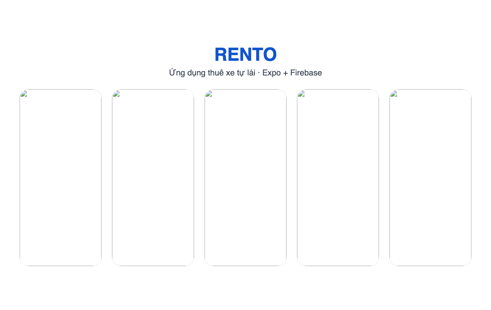

# RENTO — Ứng dụng thuê xe tự lái

RENTO là ứng dụng thuê xe trên di động, xây dựng bằng Expo Router và Firebase. Ứng dụng có màn hình chào mừng, đăng ký/đăng nhập, tìm và xem xe, đặt xe kèm dịch vụ thêm, thanh toán giả lập (Thẻ ngân hàng, MoMo, ZaloPay), hồ sơ cá nhân, xe yêu thích, thông báo và trang quản trị. Toàn bộ giao diện bằng tiếng Việt, giá tính bằng VND, địa điểm tại TP. Hồ Chí Minh, Hà Nội và Đà Nẵng.



## Ảnh chụp màn hình
Chụp trên `npm run web`, khung 390×844: chào mừng, trang Xe, chi tiết xe, đăng nhập, đăng ký. Các màn cần tài khoản (Chuyến đi, Đặt xe, Thông báo, Quản trị) chưa có ảnh.

## Tính năng
- **Chào mừng & tài khoản**: carousel giới thiệu; đăng ký có SĐT (không trùng), CCCD, địa chỉ; OTP giả lập; đăng nhập; đổi mật khẩu.
- **Tìm xe**: chọn ngày nhận – trả để chỉ hiện xe còn trống; lọc theo hãng, loại, nhiên liệu, hộp số, thành phố, số chỗ, giá; xe yêu thích.
- **Đặt xe theo ngày-giờ**: điểm nhận/trả, dịch vụ thêm, mã giảm giá (`FIRST20`, `WELCOME25`, `WEEKEND50`), VAT 10%, tiền cọc trả khi nhận xe; chặn trùng lịch; bắt buộc đã gửi GPLX.
- **Luồng đơn**: Chờ xác nhận → (RENTO xác nhận) Chờ thanh toán → (thanh toán) Sắp nhận xe → (giao xe) Đang thuê → (nhận lại xe) Hoàn thành; hoặc Bị từ chối / Đã huỷ. Huỷ ≥ 24h trước giờ nhận hoàn 100%, < 24h hoàn 70%; đổi lịch.
- **Thanh toán giả lập**: Thẻ ngân hàng / MoMo / ZaloPay, có trạng thái thất bại (thẻ thử `4000 0000 0000 0002`) và màn thanh toán thành công.
- **Đánh giá**: chỉ đánh giá được chuyến đã hoàn thành, mỗi chuyến một lần; điểm xe tự cập nhật.
- **Thông báo trong app** cho mọi sự kiện (đặt xe, xác nhận, thanh toán, giao/nhận xe, hoàn tiền, GPLX); nhắc nhận xe trong 24 giờ tới.
- **Tài khoản**: thông tin cá nhân, GPLX (gửi, chờ duyệt, bị từ chối kèm lý do), lịch sử thuê, cài đặt, trợ giúp.
- **Quản trị** (tài khoản `isAdmin`): quản lý xe và trạng thái xe, nạp xe mẫu, duyệt GPLX, xác nhận/từ chối đơn, biên bản giao xe / nhận lại xe (phí trễ, hoàn cọc), quản lý người dùng, đánh giá, báo cáo doanh thu.

## Công nghệ
- **Expo** + **React Native** + **Expo Router**
- **Firebase** (Authentication + Firestore)
- **TypeScript**
- Thư viện giao diện: **@expo/vector-icons**, **react-native-chart-kit**, **react-native-maps**, **react-native-reanimated**

## Các màn hình chính
- `/` – Màn hình chào mừng
- `/login`, `/register`, `/otp` – Đăng nhập, đăng ký, OTP
- `/(tabs)` – Trang chủ, Xe, Chuyến đi, Tài khoản
- `/car-details/[id]` – Chi tiết xe và đánh giá
- `/checkout` – Đặt xe: ngày-giờ nhận/trả, điểm nhận/trả, dịch vụ thêm, mã giảm giá
- `/booking/[id]` – Chi tiết đơn: trạng thái, giá, thanh toán/hoàn tiền, biên bản, đánh giá
- `/credit-card`, `/momo`, `/zalopay`, `/payment-success` – Thanh toán
- `/likedcars`, `/notifications`, `/developers`, `/admin`
- `/profile/*` – Thông tin cá nhân, đổi mật khẩu, GPLX, thanh toán, lịch sử, cài đặt, hỗ trợ

## Cấu trúc thư mục
```
app/                 # Màn hình (Expo Router)
  (tabs)/            # Thanh tab dưới: Trang chủ, Xe, Chuyến đi, Tài khoản
  car-details/       # Route động chi tiết xe
  booking/           # Route động chi tiết đơn
  profile/           # Các trang con của tài khoản
components/          # Component giao diện
config/              # Cấu hình Firebase
data/                # 24 xe mẫu (nạp vào Firestore từ trang quản trị), bảng ảnh
hooks/               # Hook đọc dữ liệu (xe, đơn, GPLX, đánh giá, thông báo…)
types/               # Kiểu TypeScript (hợp đồng dữ liệu)
utils/               # Nghiệp vụ (booking.ts có test), hàm ghi Firestore (*Actions.ts), hằng số, định dạng
assets/              # Hình ảnh, logo, minh hoạ
docs/PLAN.md         # Kế hoạch hoàn thiện và hợp đồng dữ liệu
firestore.rules      # Quy tắc bảo mật Firestore
```

## Dữ liệu Firebase
- **users**: hồ sơ người dùng, cờ quản trị `isAdmin`, khoá tài khoản
- **cars**: xe (giá, cọc, hộp số, tiện nghi, trạng thái, điểm đánh giá)
- **bookings**: đơn đặt xe, giá, thanh toán/hoàn tiền, biên bản giao/nhận xe
- **bookedSlots**: khoảng ngày xe đang bị giữ (để kiểm tra xe trống)
- **licenses**: giấy phép lái xe (ảnh, trạng thái duyệt)
- **reviews**: đánh giá theo chuyến đã hoàn thành
- **notifications**, **likedCars**, **phones** (chặn trùng SĐT), **supportTickets**

Chi tiết từng field: `docs/PLAN.md` mục 4. Cấu hình Firebase nằm ở `config/firebase.ts`.

## Cài đặt
1. Cài thư viện: `npm install`
2. (Tuỳ chọn) Thay cấu hình Firebase trong `config/firebase.ts` và project trong `.firebaserc` bằng dự án của bạn.
3. Deploy quy tắc bảo mật Firestore: `npx firebase-tools login` rồi `npx firebase-tools deploy --only firestore:rules`.
4. Chạy ứng dụng: `npm run start`
5. Tạo tài khoản quản trị: đăng ký một tài khoản trong app → Firebase Console → Firestore → `users/{uid}` → thêm field `isAdmin = true` (boolean). Đăng nhập lại bằng tài khoản này sẽ vào thẳng trang quản trị.
6. Nạp dữ liệu xe: trong trang quản trị, tab Xe → "Nạp dữ liệu xe mẫu" (thêm 24 xe, bỏ qua xe đã có).

### Chạy trên từng nền tảng
- Android: `npm run android`
- iOS: `npm run ios`
- Web: `npm run web`

## Lệnh
- `start` – chạy Expo
- `android` – chạy và mở trình giả lập Android
- `ios` – chạy và mở trình giả lập iOS
- `web` – chạy bản web
- `test` – chạy Jest (một lần: `npx jest --watchAll=false`)
- Kiểm tra kiểu: `./node_modules/.bin/tsc --noEmit -p .`

## Ghi chú
- Trang quản trị chỉ dành cho tài khoản có `users/{uid}.isAdmin = true`; Firestore rules cũng dựa vào cờ này.
- Thanh toán và OTP là giả lập; thông báo chỉ trong app (không push).
- Kiểm tra trùng lịch chạy phía ứng dụng; quản trị viên kiểm tra lại khi xác nhận đơn.
- Trên bản web, bộ chọn ngày dùng phương án dự phòng (chip ngày/giờ).

## Giấy phép
MIT
